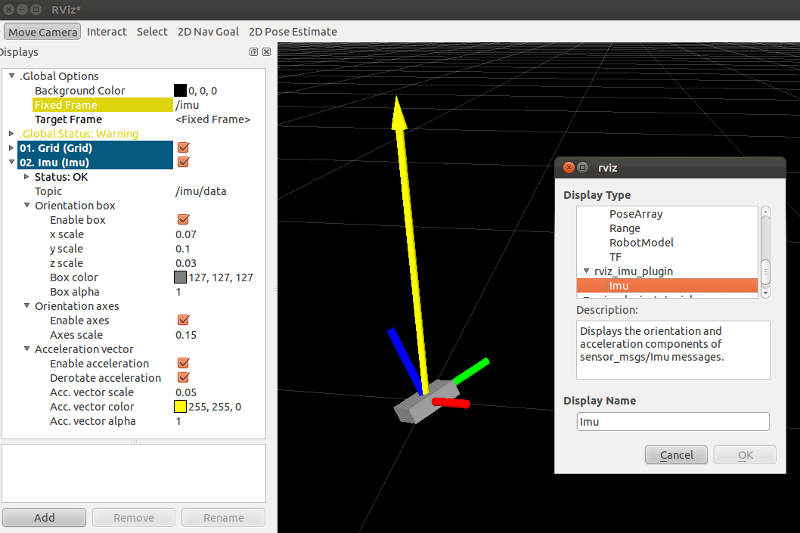

## Details

The rviz_imu_plugin package is used to display
[sensor_msgs/msg/Imu](https://docs.ros.org/en/rolling/p/sensor_msgs/msg/Imu.html)
messages in [rviz](https://index.ros.org/p/rviz). Once you install
the package, it should be visible as a plugin.

It displays the orientation of the IMU using a box as well as
coordinate axes. The acceleration can be visualized using a vector.

